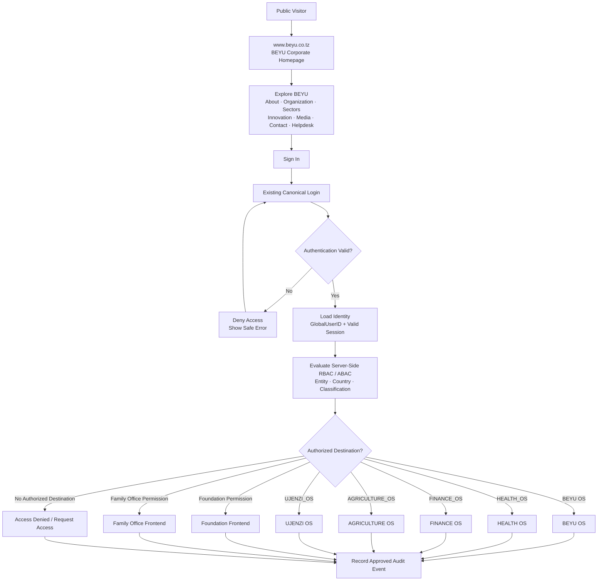
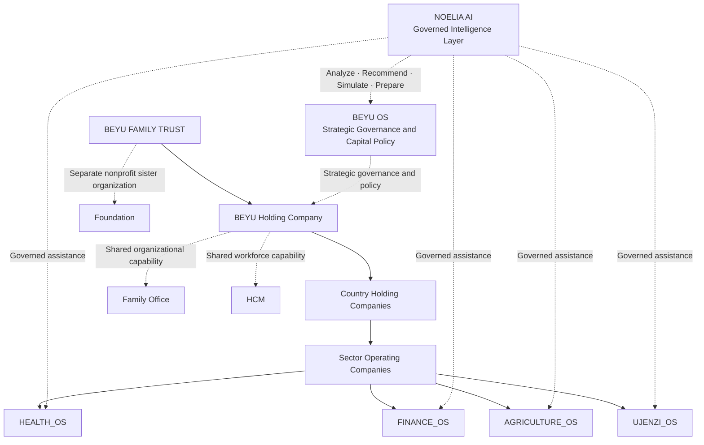
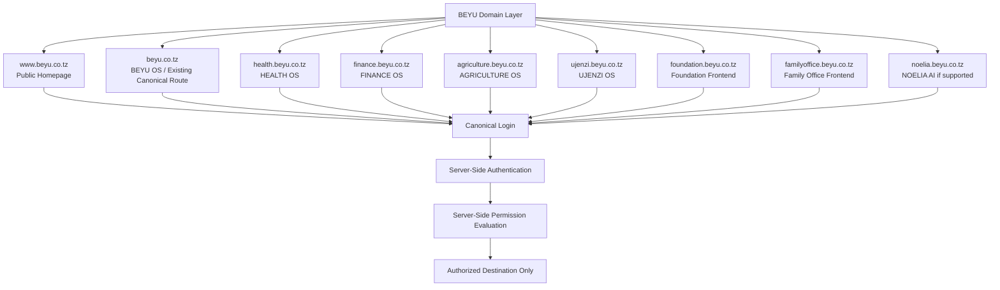

# BEYU OS — Public Corporate Website, Organizational Architecture, Authentication & Workspace Routing

Status: **CANONICAL ARCHITECTURAL RECORD** · Verified against Repository State (Branch `arena/91816a93-beyu-os-1-0`)  
Date: 2026-10-23  
Target Hosts: `www.beyu.co.tz`, `beyu.co.tz`, `health.beyu.co.tz`, `finance.beyu.co.tz`, `agriculture.beyu.co.tz`, `ujenzi.beyu.co.tz`, `foundation.beyu.co.tz`, `familyoffice.beyu.co.tz`, `noelia.beyu.co.tz`

---

## 1. Executive Architecture Summary

BEYU is the **Constitutional Control Plane + Enterprise Operating Kernel + Governed Intelligence Layer** of the BEYU ecosystem.

- **Constitutional Parent**: `BEYU FAMILY TRUST`
  - → `BEYU Holding Company`
    - → `Country Holding Companies`
      - → `Sector Operating Companies`
- **Canonical Sector OS Set (Exactly 4)**:
  1. `HEALTH_OS` — Federated healthcare operations, clinical standards, safeguarding
  2. `FINANCE_OS` — Canonical financial truth, chart of accounts, immutable ledger, capital policy
  3. `AGRICULTURE_OS` — Cultivation, livestock, crop cycles, food security, export traceability
  4. `UJENZI_OS` — Governed construction, BOQ, site operations, contractor verification
- **Nonprofit Sister Organization**:
  - `BEYU Foundation` is a **separate nonprofit sister organization**. It is **not** a Holding Company subsidiary, Sector LLC, or Sector OS. It operates in its own legal-entity and tenant scope under shared constitutional oversight.
- **Shared Enterprise Capabilities**:
  - `Family Office` — A shared organizational capability and dedicated workspace (`/os/family`), not an OS.
  - `HCM` (Human Capital Management) — A first-class shared capability with one canonical employee master identity; no shadow workforce, no separate `HCM_OS`.
  - `NOELIA AI` — Canonical identifier `NOELIA_AI`, display name **NOELIA**, epithet *Queen Bee*, motto *Intelligence • Governance • Care*. Governed intelligence layer operating over the HIVE runtime. Assistance is strictly advisory (analyze, recommend, summarize, simulate, prepare); NOELIA never independently executes material transactions or bypasses human approval, policy, or audit controls.

---

## 2. Mermaid Architecture Diagrams

### Diagram A: Public Visitor to Authorized Workspace Journey

### Diagram B: Canonical Organizational Architecture

### Diagram C: Intended Domain and Frontend Routing

---

## 3. The Seven Authorized Destination Workspaces

Post-login routing strictly enforces server-side identity, RBAC/ABAC, tenant/entity/country isolation, and cryptographic audit:

| # | Workspace Destination | Category | Subdomain Host | Internal Route | Access Resolver / Gate |
|---|---|---|---|---|---|
| 1 | **BEYU OS** | Constitutional Control Plane | `beyu.co.tz` / apex | `/os` | `checkBeyuOSAuthorization(principal)` |
| 2 | **HEALTH OS** | Sector Operating System | `health.beyu.co.tz` | `/os/health` (mount at `/health/os`) | `checkHealthOSAuthorization(principal)` & Federation Gate |
| 3 | **FINANCE OS** | Sector Operating System | `finance.beyu.co.tz` | `/os/finance` | `finance:ledger.read`, `finance:periods.read` |
| 4 | **AGRICULTURE OS** | Sector Operating System | `agriculture.beyu.co.tz` | `/os/agriculture` | `governedTenantInScope("BEYU-AGRI")` |
| 5 | **UJENZI OS** | Sector Operating System | `ujenzi.beyu.co.tz` | `/os/ujenzi` | `governedTenantInScope("BEYU-UJENZI")` |
| 6 | **Foundation Frontend** | Nonprofit Sister Organization | `foundation.beyu.co.tz` | `/os/foundation` | `governedTenantInScope("BEYU-FOUNDATION")` & `foundation:registry.read` |
| 7 | **Family Office Frontend** | Shared Organizational Capability | `familyoffice.beyu.co.tz` | `/os/family` | `family:member.read` (restricted clearance) |

*Note on NOELIA AI*: `noelia.beyu.co.tz` maps to `/os/noelia` gated on `ai:noelia.query`. NOELIA is an advisory intelligence interface, not an OS.

---

## 4. Hostname Security & Fail-Closed Invariants

1. **Hostname is Context, Never Authorization**: Arriving on `health.beyu.co.tz` identifies presentation context only. It never mints roles, clears tenant boundaries, or bypasses authorization.
2. **Server-Side Evaluation**: All permission decisions occur server-side through `can()`, `authorizedGovernedDestinations()`, and tenant context setters.
3. **Fail-Closed Default**: If an identity holds no active grant for a destination, the system displays `DestinationDenied` or redirects to a safe unprivileged refusal; it never defaults to granting access or promoting privileges.
4. **No Direct Browser Database Access**: Frontends never connect directly to PostgreSQL. All interactions pass through typed server actions and guarded route handlers with Row Level Security (RLS) enforced.
5. **Session Scoping and Anti-Open-Redirect**: Redirection targets are validated strictly against internal allowlists. The session cookie is `httpOnly`, `SameSite=lax`, and `Secure`.
